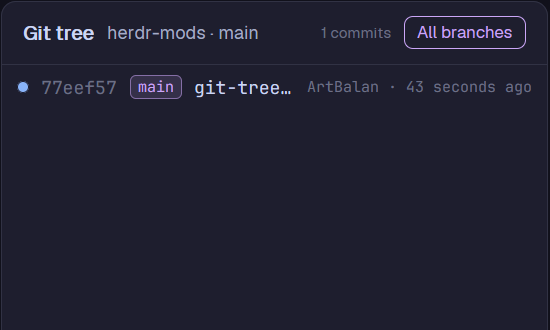

# herdr-git-tree

A [Herdr](https://herdr.dev) mod: [`git-tree`](git-tree/RECIPE.md).

A Git graph of the focused terminal's repo, drawn as real lanes: commit dots, merges and
branch-offs, branch and tag chips on each commit. Click a commit to see its message and
changed files. It follows whichever terminal you focus, on any machine, and refreshes by
itself when the repo changes.

## Install

Ask an agent in Herdr to add `http://mnemosyne:3000/enexolgort/herdr-git-tree/src/branch/main/git-tree`,
or by hand:

1. Copy `git-tree/mods/git-tree` to `~/.config/herdr-app/mods/`.
   The first time Herdr sees it, it docks on the right of the shown layout (420 px).
2. Optional: merge `git-tree/keys.json` into `~/.config/herdr-app/keys.json`. It adds
   `ctrl-shift-g`, which splits a Git tree pane to the right of the focused one.
   Skip it if you already use that key.
3. Run `herdr-app check ~/.config/herdr-app/mods/git-tree`.

As a layout panel (in a stack next to Files and Changes), give the block
`"props": { "panel": true }` so it draws its own card like Changes does.

## What it runs

Read-only `git` in the focused terminal's folder, on that terminal's machine
(`rev-parse`, `branch --show-current`, `log --graph`, `show --stat`), with
`--no-optional-locks` and `core.fsmonitor=false` so it never writes to `.git`.
It watches the repo's `.git` folder for changes (local spaces) and refreshes every 15 s.
No network, no writes.

## License

Apache-2.0 (see `LICENSE`).
