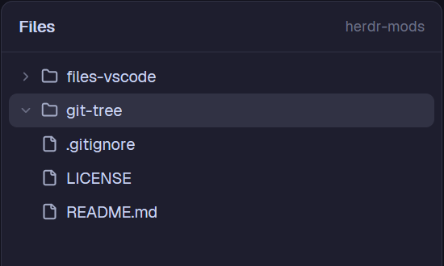

# herdr-mods

Two [Herdr](https://herdr.dev) mods, one folder each:

| Mod | What it does |
| --- | --- |
| [`git-tree`](git-tree/RECIPE.md) | A Git graph of the focused terminal's repo: lanes, branches and tags, commit details on click. |
| [`files-vscode`](files-vscode/RECIPE.md) | Herdr's Files panel, plus a right-click menu on any file or folder: **Open in VS Code**. |

| Git tree | Files + VS Code |
| --- | --- |
|  |  |

## Install

Ask an agent in Herdr to add `http://mnemosyne:3000/enexolgort/herdr-mods/src/branch/main/git-tree`
(or `.../files-vscode`), or by hand:

### git-tree

1. Copy `git-tree/mods/git-tree` to `~/.config/herdr-app/mods/`.
   The first time Herdr sees it, it docks on the right of the shown layout (420 px).
2. Optional: merge `git-tree/keys.json` into `~/.config/herdr-app/keys.json`. It adds
   `ctrl-shift-g`, which splits a Git tree pane to the right of the focused one.
   Skip it if you already use that key.
3. `herdr-app check ~/.config/herdr-app/mods/git-tree`

As a layout panel (in a stack next to Files and Changes), give the block
`"props": { "panel": true }` so it draws its own card like Changes does.

### files-vscode

1. Copy `files-vscode/mods/files-vscode` to `~/.config/herdr-app/mods/`.
2. Point your layout's Files block at it. Herdr's own layouts are read-only, so
   clone yours first if it's a shipped one:
   ```sh
   herdr-app do layout.clone '{"name":"main","as":"my-layout"}'
   ```
   then in `layouts/my-layout.json` change `"mod": "files"` to `"mod": "files-vscode"`.
3. `herdr-app check ~/.config/herdr-app/mods/files-vscode`

Needs VS Code's `code` command on your PATH (in VS Code: *Shell Command: Install 'code'
command in PATH*; the Windows installer adds it).

## What they run

- **git-tree:** read-only `git` in the focused terminal's folder, on that terminal's
  machine (`rev-parse`, `branch --show-current`, `log --graph`, `show --stat`), with
  `--no-optional-locks` and `core.fsmonitor=false` so it never writes to `.git`.
  It watches the repo's `.git` folder for changes (local spaces) and refreshes every 15 s.
  No network, no writes.
- **files-vscode:** everything Herdr's Files panel runs (`git status`, a folder listing
  through `sh`, or PowerShell on Windows). Opening in VS Code runs `code <path>` locally
  (through `powershell Start-Process` on Windows, since `code` is a `.cmd`), or
  `code --remote ssh-remote+<machine> <path>` for a space on another machine. That one
  needs the Remote-SSH extension and the Herdr machine name to be an SSH host. No network.

## License

Apache-2.0 (see `LICENSE`). `files-vscode` is modified from Herdr's shipped `files`
mod (Apache-2.0), including its icons; the changes are marked `files-vscode:` in the source.
