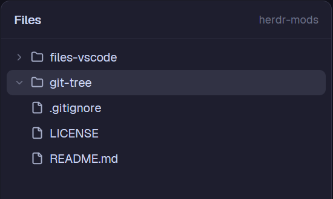

# Files + VS Code

Herdr's Files panel (a lazy tree of the focused terminal's folder with Git marks and read-only
previews), with one addition: right-click any file or folder and pick **Open in VS Code**.

## What you see

- Everything the shipped `files` mod shows: a 42 px header ("Files", the folder or previewed
  file's name on the right), a tree of 28 px rows (chevron, file/folder icon, name, Git mark
  `A` `M` `D` `U`), and a code preview when a file is clicked.
- **Right-click menu**: a popup at the pointer, 190 × 40 px, `popover` background, 5 px
  padding, one 30 px row (radius 7, `selected` on hover): the file or folder icon in `muted`
  and "Open in VS Code" at 12.8 px.

## How it behaves

- Right-click a row (file or folder) → the menu opens at the pointer. Left-click still
  expands folders and previews files. Esc or clicking elsewhere closes the menu.
- **Open in VS Code** closes the menu and opens that path in VS Code (a folder as a
  workspace, a file in the current window).
  - This computer, Windows: `powershell -NoProfile -Command Start-Process -FilePath code
    -WindowStyle Hidden -ArgumentList @('"<path>"')`, with `/` turned into `\`.
  - This computer, macOS/Linux: `code <path>`.
  - A space on another machine: `code --remote ssh-remote+<machine> <path>`.
  - If it fails, an error toast "Could not open VS Code" with stderr.

## Built from

- A clone of the shipped `files` mod (`herdr-app do mod.clone '{"name":"files","as":"files-vscode"}'`),
  so every `mods/files/` asset path is `mods/files-vscode/`.
- The menu is the same mod opened as a popup:
  `openOverlay({ mod: "files-vscode", kind: "popup", at: "pointer", width: 190, height: 40,
  props: { menu: { path, on, dir } } })` from `.on_mouse_down("right", …)` on each row
  (with `cx.stop_propagation()`). In `init`, a copy with `props().menu` skips the file tree
  entirely; `render` returns the menu.
- `herdr`: `props`, `openOverlay`, `closeOverlay(props().overlay)`, `notify`, `exec`, `window().platform`.
- Used in a layout by setting the Files block to `"mod": "files-vscode"` (clone a shipped layout first).

## Watch out

- On Windows `code` is `code.cmd`, which `exec` can't start directly. Calling `Code.exe`
  directly blocks `exec` until the 30 s timeout when VS Code wasn't already running.
  `Start-Process` returns at once.
- Quote for PowerShell: wrap the path in `'"…"'` (so `Start-Process` keeps spaces as one
  argument) and double every `'` (and `‘ ’ ‚ ‛`, which PowerShell also reads as quotes).
  Paths with spaces, `&`, `$`, `(` must open the right folder.
- Remote opening assumes the Herdr machine name is an SSH host VS Code's Remote-SSH can reach.
- Being a clone, it doesn't get Herdr's future fixes to `files`: re-clone and re-apply the
  `files-vscode:` changes after a Herdr update if you want them.

## Done when

- Right-clicking a folder, then Open in VS Code, opens that folder in VS Code.
- Same for a file; the menu shows a file icon for files and a folder icon for folders.
- A folder named `it's a (test) & $x` opens correctly.
- Left-click behaviour (expand, preview) is unchanged.
- `herdr-app check mods/files-vscode` passes.
