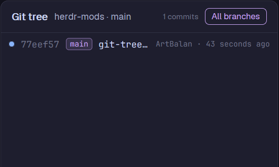

# Git tree

A panel that draws the Git history of the repo the focused terminal is in, as a real graph:
coloured lanes, commit dots, merges and branch-offs, with branch and tag chips on each commit.
Click a commit to see its message and changed files underneath.

## What you see

- **Header** (42 px, bottom border `border`): "Git tree" in 13 px semibold, then
  `<repo> · <branch>` in `muted` (truncated), then on the right the commit count in 10 px
  `dim` (`400+` when capped) and a toggle pill (22 px high, radius 6): **All branches**
  (accent border and text) or **This branch** (`border` / `muted`).
- **Graph** (the rest, in the terminal font at 12 px): one 22 px row per commit, 12 px rows
  for lines that are only branch lanes. Each row: the graph, the short hash in `dim`, ref
  chips, the subject (`foreground`, truncated), then `author · 3 days ago` in 10 px `dim`.
  - Lanes are 8 px wide, coloured in turn from `ansi4, ansi5, ansi2, ansi3, ansi6, ansi1,
    ansi12, ansi13, ansi10, ansi11`. A lane is a 2 px line; a commit is an 8 px dot on it
    with a `background` ring; `/` and `\` are drawn as SVG diagonals reaching the
    neighbouring lane's centre, so straight histories stay connected.
  - Ref chips (16 px high, radius 4, 10 px text, max 140 px): `HEAD -> x` and `HEAD` in
    `accent`, tags (`tag: ` stripped) in `ansi3`, remote branches (`origin/x`) in `ansi1`,
    local branches in `ansi4`; border colour at `88` alpha, fill at `22`.
- **Detail** (220 px, top border, 11 px mono), shown while a commit is selected: the output of
  `git show --stat` (full hash in `ansi3`, stat lines in `muted`), up to 300 lines, scrollable.
- Empty states in `dim`: "Not a git repository", "No commits yet", "No folder", "Loading…".

## How it behaves

- Follows the focused terminal: its live folder and machine. When a mod pane has focus, it
  uses a terminal in the same tab. Switching space, tab or pane redraws for that repo.
- Refreshes when anything in the repo's `.git` folder changes (local only), and every 15 s.
  Only the newest refresh writes results, so a slow `git` never blocks later ones.
- Click a commit to select it (`selected` background) and load its details; click it again
  to close them. Rows hover in `hover`.
- **All branches / This branch** switches between `git log --all` and the current branch;
  the choice is kept per copy in `localStorage`.
- Agent statuses don't apply; it has no keys of its own.

## Built from

- One mod, `mods/git-tree/` (`main.js`, `mod.json` `{ "place": "right", "size": 420 }`,
  `git-tree.svg` (the panel icon, for a tab bar button), `slash.svg` and `backslash.svg`
  (`preserveAspectRatio="none"` diagonals, tinted with `text_color`).
- `herdr`: `spaces()`, `panes()`, `focused()` for the location; `exec("git", …, { cwd, on })`;
  `watchFolder(gitDir)`; `theme()`, `settings().font_family`; `props().panel`.
- Git: `rev-parse --show-toplevel --absolute-git-dir`, `branch --show-current`,
  `log --graph --date-order -n400 [--all] --format=<\x1f-separated %h %H %D %s %an %cr>`,
  `show --stat --no-color`; every call with `--no-optional-locks -c core.fsmonitor=false
  -c color.ui=never`.
- `props: { "panel": true }` when it sits in a layout stack: it draws its own rounded card with
  a border (like the shipped Changes panel). As a pane, the pane frame does that.
- Optional `keys.json`: `ctrl-shift-g` → `pane.split {direction: "right", mod: "git-tree"}`.

## Watch out

- Without `--no-optional-locks` and `core.fsmonitor=false`, git's own reads touch `.git`,
  which wakes the folder watch, which refreshes again: an endless loop.
- Git's text graph only puts `|` between side-by-side branches, so typing the graph as text
  leaves a straight history as unconnected dots. Draw lanes; join a `*` up or down only when
  the row above/below continues that lane (`|`, `*`, or a diagonal pointing into it).
- Capped at 400 commits. Remote spaces have no folder watch, only the 15 s timer.
- On Windows `git` prints `\r\n`: strip `\r` before parsing.

## Done when

- In a repo with merges, lanes are continuous lines and merges/branch-offs join the right lanes.
- Committing in a terminal shows the new commit within a second or two (local repo).
- Clicking a commit shows its `git show --stat`; clicking again hides it.
- The toggle switches between all branches and the current one and stays after a reload.
- Focusing a terminal outside a repo shows "Not a git repository".
- `herdr-app check mods/git-tree` passes.
